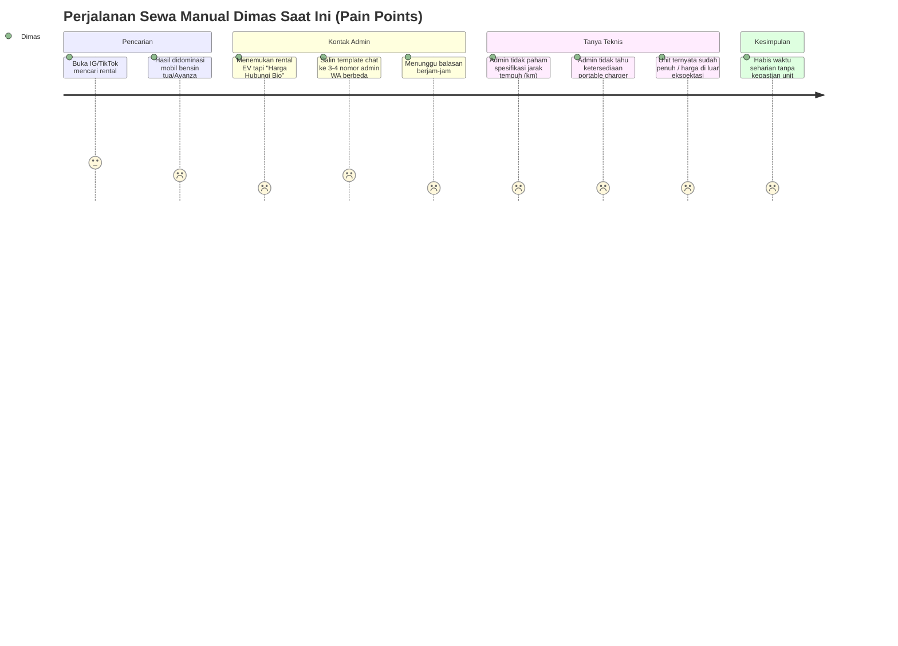
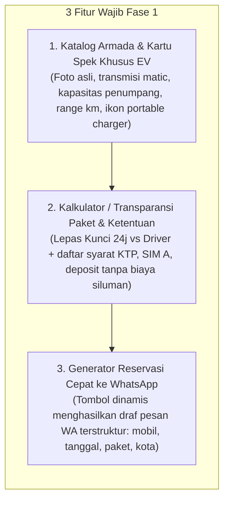
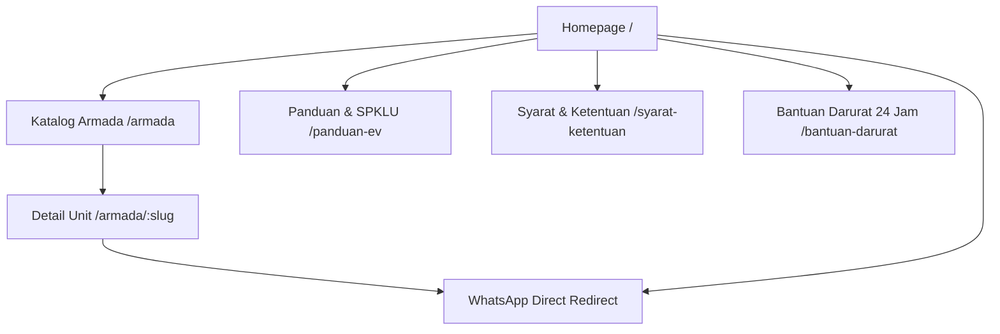
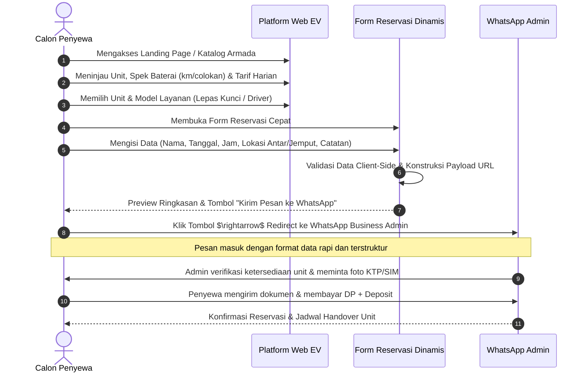
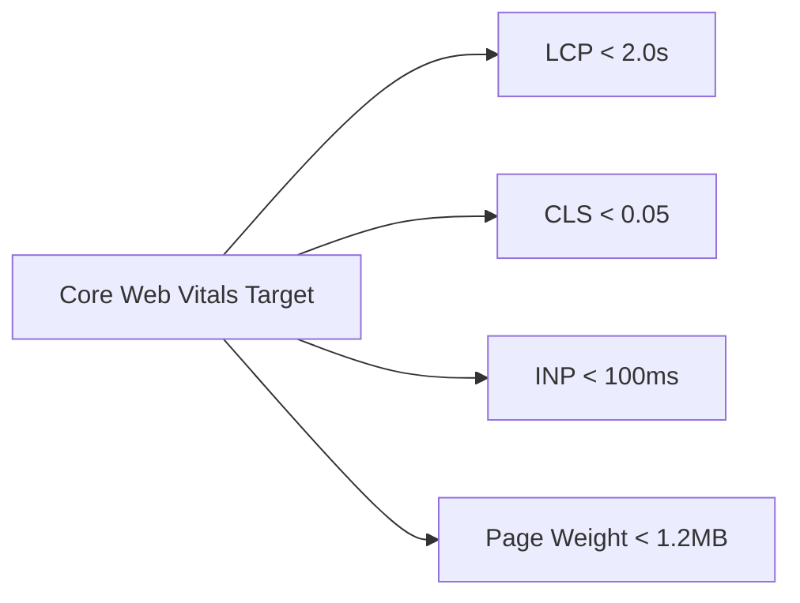
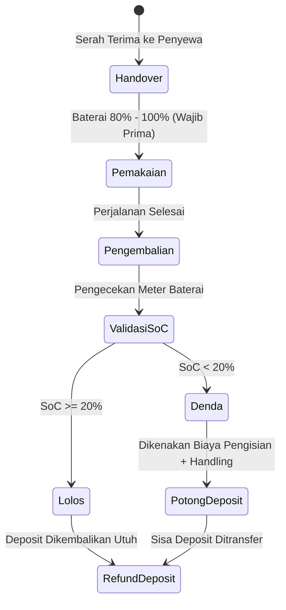
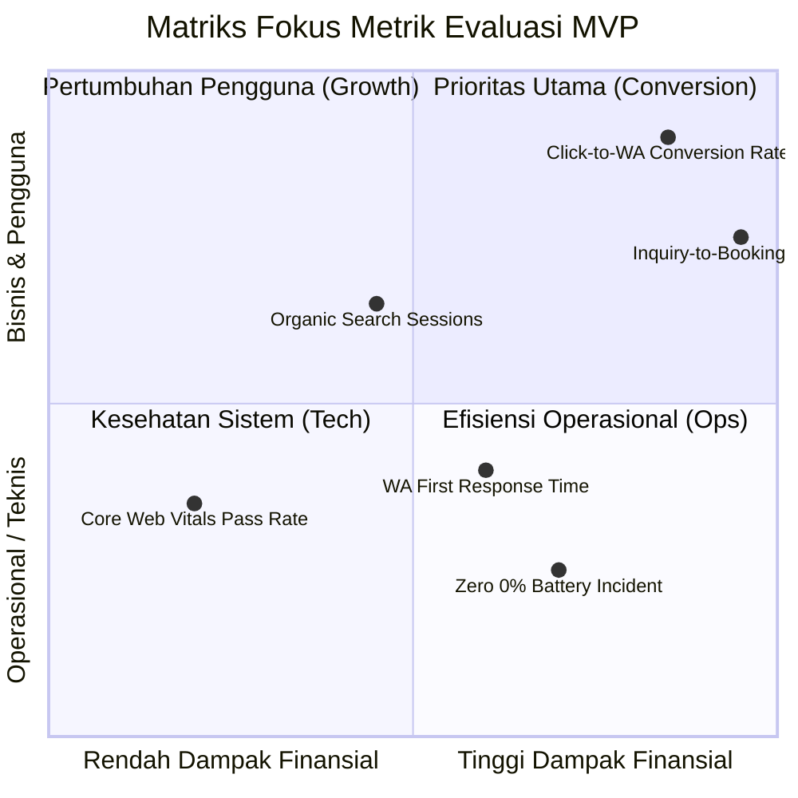
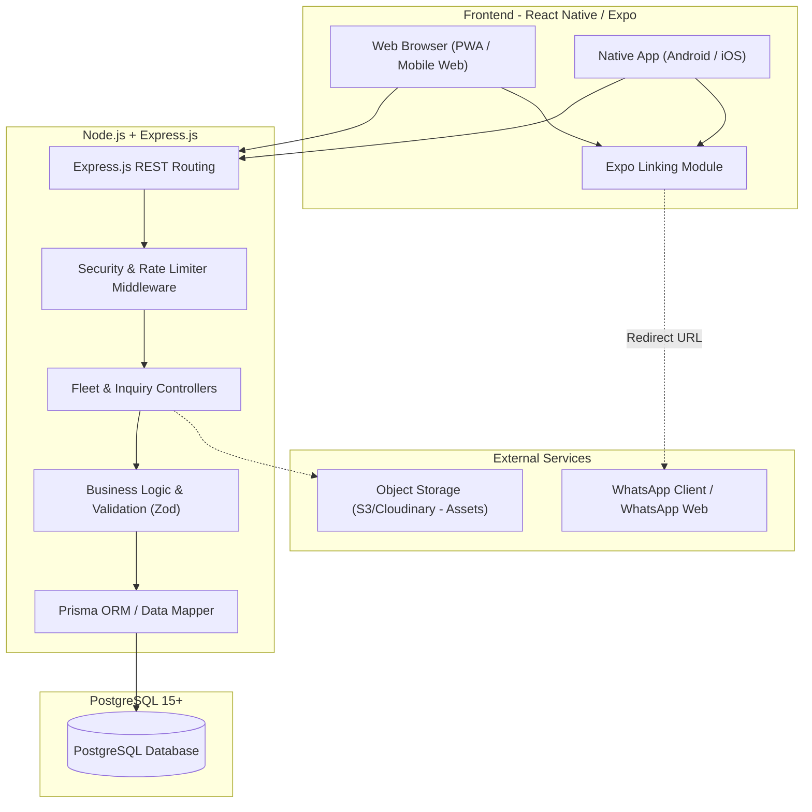
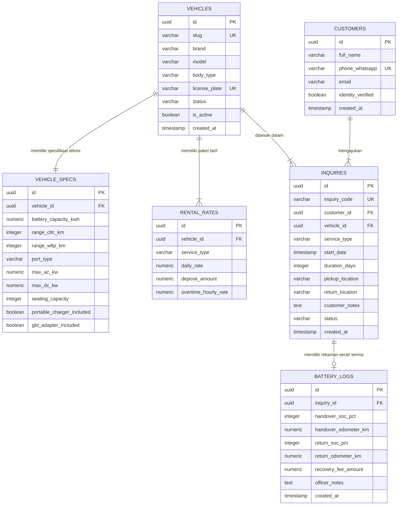

# PRODUCT REQUIREMENT DOCUMENT (PRD)
## Platform Web Rental Mobil Listrik (EV) Mandiri Skala Rintisan

| Atribut Dokumen | Informasi |
| :--- | :--- |
| **Nama Proyek** | Platform Web Rental Mobil Listrik Mandiri (B2C Retail & Tourism) |
| **Versi Dokumen** | v1.0.0 (MVP Release) |
| **Status** | Approved for Development |
| **Disusun Oleh** | Senior Product Manager (Mobility & E-Commerce) |
| **Target Rilis MVP** | Q2 / Sprint 1–2 |
| **Platform Target** | Responsive Web (Mobile-First Architecture) |

---

## 1. Executive Summary & Product Vision

### 1.1 Visi Produk
Menjadi platform digital rental kendaraan listrik (*Electric Vehicle* / EV) lokal independen yang paling tepercaya, transparan, dan mudah diakses bagi wisatawan serta konsumen retail. Platform ini dirancang untuk menghadirkan pengalaman transisi ke mobilitas ramah lingkungan yang menyenangkan, bebas dari kecemasan jarak tempuh (*range anxiety*), dengan standar layanan profesional setara operator korporat ternama (benchmarking: INDORENT), namun dengan fleksibilitas dan transparansi harga khusus pasar retail.

### 1.2 Target Persona Utama: Dimas (The Tech-Savvy Family & Urban Professional)



* **Profil Lengkap**: **Dimas (32 tahun)**, profesional muda yang sedang merencanakan liburan keluarga kecil selama 3–4 hari atau perjalanan dinas di kota tujuan (misal: Bali, Yogyakarta, Bandung, Jakarta).
* **Motivasi Utama**: Penasaran ingin mencoba mengemudikan mobil listrik modern (seperti Wuling Binguo atau BYD Atto 3/M6), mendambakan kabin hening tanpa getaran mesin untuk kenyamanan keluarga, dan ingin berhemat biaya operasional dibandingkan mobil bensin konvensional.
* **Kebiasaan Sewa Dimas Saat Ini (*Current Behavior & Pain Points*)**:
  1. **Mencari lewat Instagram/TikTok**: Mengetik tagar sewa mobil di kota tujuan, namun 90% hasil yang muncul adalah mobil bensin konvensional (*ICE*) seperti Avanza atau Innova lama.
  2. **Harga Serba Gelap (*Dark Pricing*)**: Saat menemukan postingan rental EV, caption hanya mencantumkan "Harga & Ketersediaan Unit Hubungi Bio/WA". Tidak ada patokan tarif sama sekali.
  3. **Mengirim Pesan ke Banyak Admin**: Dimas harus menyalin-tempel format chat dan menyapa 3–4 admin rental berbeda. Respons admin sering kali lambat (butuh waktu berjam-jam).
  4. **Informasi Teknis EV Tidak Jelas**: Saat chat dibalas, admin sering kali tidak paham spesifikasi mendasar ketika Dimas bertanya: *"Baterainya tahan berapa kilometer ya? Disediakan charger colokan rumah (portable) tidak?"*. Ada pula admin yang baru mengabarkan bahwa unit sudah penuh setelah percakapan panjang.
  * **Kesimpulan Pain Point**: Dimas menghabiskan waktu seharian penuh hanya untuk menanyakan ketersediaan dan tarif satu unit mobil listrik.

---

### 1.3 The 5–10 Seconds First Impression Rule (Mencegah Bounce Rate)
Pengunjung yang tertarik menyewa mobil listrik memiliki dua keraguan psikologis terbesar: **Harga Sewa** dan **Jarak Tempuh Baterai (*Range Anxiety*)**. 

Platform web ini menerapkan **Aturan 5–10 Detik Pertama**: Begitu Dimas membuka website, pandangan matanya langsung tervalidasi dengan tiga elemen esensial tanpa perlu scroll berlebihan:
1. **Foto Unit Asli, Bersih & Profesional**: Visual etalase rapi mengadopsi standar kepercayaan INDORENT.
2. **Estimasi Tarif Harian Transparan**: Angka jelas terpampang (contoh: *"Mulai Rp350.000/hari"*).
3. **Ringkasan Spesifikasi Baterai**: Label ringkas padat informasi (contoh: *"Baterai Penuh: $\pm$ 300–410 km • Termasuk Portable Charger"*).

> **Efek Produk**: Validasi instan ini memberikan kepastian dalam hitungan detik bahwa Dimas berada di platform yang tepat, mengeliminasi risiko keluar dari website (*bounce*), dan mendorong klik langsung ke detail unit atau reservasi.

---

### 1.4 Nilai Pembeda: Mengapa Website Ini Menang Telak vs Cara Manual?

| Parameter Pengalaman | Cara Sewa Manual (Medsos/Chat) | Platform Web Rental EV Mandiri | Dampak bagi Penyewa (Dimas) |
| :--- | :--- | :--- | :--- |
| **Beban Mental Eksplorasi** | Canggung dan sungkan bertanya jika belum pasti menyewa. | *Zero Pressure Exploration*: Bebas membandingkan kapasitas, harga, & syarat kapan saja. | Keputusan sewa lebih matang dan tanpa tekanan. |
| **Edukasi Teknologi EV** | Admin lambat / tidak mengerti jarak tempuh & jenis colokan. | Menjawab keraguan di depan: Tabel jarak tempuh, tipe port, & panduan SPKLU siap baca. | Percaya diri mengendarai EV tanpa rasa takut mogok. |
| **Citra Kepercayaan (Trust)** | Akun perorangan medsos rawan penipuan uang muka (DP). | Desain profesional ala INDORENT dengan garansi mobil pengganti 24 jam. | *Peace of mind* saat membayar deposit jaminan. |
| **Efisiensi Chat WhatsApp** | Percakapan manual panjang & berulang-ulang untuk data dasar. | *High-Velocity Handoff*: Admin menerima draf data pesanan lengkap dalam 1 klik. | Chat langsung fokus ke verifikasi dokumen & jadwal kirim unit. |

---

### 1.5 Siklus Retensi Pengguna (Customer Retention Loop)
Mengapa penyewa seperti Dimas akan selalu kembali menyewa melalui website ini saat perjalanan berikutnya?
1. **Kepastian Tarif & Bebas Biaya Tak Terduga**: Transparansi biaya sejak awal tanpa biaya siluman saat pengembalian unit menciptakan reputasi integritas tinggi.
2. **Ketenangan Pikiran (*Peace of Mind*)**: Unit selalu diserahkan dengan baterai prima ($\ge 80\%$) dan jaminan derek/mobil pengganti 24 jam menghilangkan kekhawatiran selama liburan.
3. **Pemesanan Ulang Cepat (*Fast Re-Booking*)**: Data pelanggan yang sudah terverifikasi tersimpan aman di database PostgreSQL. Pada penyewaan berikutnya, Dimas cukup memilih unit di web dan mengonfirmasi via WhatsApp tanpa perlu mengulang proses verifikasi identitas dari nol.

---

## 2. Scope & Release Strategy

### 2.1 Tiga Fitur Paling Wajib untuk Fase Pertama (MVP Core Trio)
Untuk memangkas *time-to-market* dan memfokuskan sumber daya rintisan pada alur transaksi yang paling menghasilkan konversi, **3 Fitur Utama** ditetapkan sebagai prioritas mutlak, sementara fitur kompleks seperti registrasi akun pengguna, pembayaran kartu kredit otomatis, dan integrasi IoT telematics ditunda ke fase berikutnya:



1. **Fitur 1: Katalog Armada & Kartu Spesifikasi Khusus EV**
   * Menampilkan foto mobil asli beresolusi tinggi, transmisi otomatis, kapasitas penumpang & bagasi, estimasi jarak tempuh baterai penuh (km), serta ikon penegas kelengkapan portable home charger.
2. **Fitur 2: Kalkulator / Transparansi Paket Sewa & Ketentuan Terbuka**
   * Penjelasan gamblang perbedaan paket (Lepas Kunci 24 jam vs Dengan Driver harian) beserta syarat dokumen verifikasi (e-KTP, SIM A, bukti tiket/hotel, nominal deposit) agar penyewa tidak merasa terjebak biaya siluman.
3. **Fitur 3: Generator Reservasi Cepat ke WhatsApp (WhatsApp-First Booking)**
   * Tombol aksi di setiap halaman unit yang langsung mengonversi input formulir menjadi pesan WhatsApp rapi dan terstruktur, menghemat waktu admin dan calon penyewa hingga 80%.

### 2.2 Matriks Perbandingan MVP vs Future Releases

| Fitur / Modul | MVP (Fase 1: Core Trio) | Fase 2 (Semi-Automated) | Fase 3 (Full Digital Platform) |
| :--- | :--- | :--- | :--- |
| **Katalog Armada** | 2–10 unit dengan tag spesifikasi EV & filter kategori | Filter lanjutan (kapasitas baterai, radius tempuh) | Sinkronisasi inventori dinamis & multi-cabang |
| **Pricing Engine** | Estimasi tarif flat harian (Lepas Kunci & Driver) | Dynamic weekend/holiday pricing rule | Otomatisasi diskon durasi sewa & kupon promo |
| **Alur Reservasi** | Form Reservasi Cepat $\rightarrow$ WhatsApp URL Generator | Form upload KTP/SIM dengan Auto-Watermark | Booking engine instan dengan pemilih slot tanggal |
| **Sistem Pembayaran** | Manual transfer via chat WhatsApp admin (DP + Deposit) | Payment Gateway (VA, QRIS, Kartu Kredit) | Auto-escrow & auto-refund deposit jaminan |
| **Edukasi EV** | Panduan charging ringkas, diagram colokan & direktori SPKLU | Peta interaktif SPKLU terintegrasi Google Maps | Rekomendasi rute wisata ramah SPKLU berbasis AI |
| **Telematika Armada** | SOP manual (foto odometer & baterai saat serah terima) | Form digital Checklist Handover (Web form) | Integrasi IoT/OBD-II (live telemetry SoC & GPS) |
| **User Account** | Tanpa Login (Cukup nomor WhatsApp terverifikasi) | Profil penyewa & riwayat sewa via OTP WA | Dashboard membership & reward point |

### 2.3 Strategi Rilis MVP
1. **Tahap Alpha (Internal Testing)**: Uji kompatibilitas URL Generator WhatsApp lintas perangkat (Android, iOS, Desktop), verifikasi kecepatan LCP, dan testing visual pada berbagai resolusi layar.
2. **Tahap Beta (Soft Launch)**: Peluncuran ke pasar terbatas di 1 kota operasional (fokus 4–6 unit armada: Wuling Air EV, Binguo EV, BYD Atto 3/M6).
3. **Evaluasi MVP (Bulan 1–2)**: Pengukuran rasio konversi klik ke WhatsApp (*Click-to-WA*), volume leads harian, serta feedback penyewa mengenai kejelasan informasi EV.

---

## 3. Information Architecture & Sitemap



### 3.1 Deskripsi Struktur Halaman
1. **Homepage (`/`)**: Halaman etalase utama yang berfokus pada konversi, sinyal kepercayaan, perkenalan armada unggulan, keunggulan EV, dan quick reservation widget.
2. **Katalog Armada (`/armada`)**: Direktori seluruh unit kendaraan yang dapat difilter berdasarkan model layanan (Lepas Kunci / Driver) dan ukuran kendaraan (City Car / Compact SUV / MPV).
3. **Vehicle Detail Page (`/armada/[slug]`)**: Spesifikasi mendalam per model mobil listrik (jarak tempuh, waktu pengisian daya, tipe charger, paket harga harian, kelengkapan unit, dan tombol reservasi).
4. **Panduan & Peta SPKLU (`/panduan-ev`)**: Edukasi interaktif bagi penyewa baru mencakup cara cas mandiri menggunakan portable charger, panduan aplikasi PLN Mobile / SPKLU komersial, serta perbedaan colokan.
5. **Syarat, Ketentuan & Verifikasi (`/syarat-ketentuan`)**: Informasi transparan mengenai persyaratan dokumen lepas kunci, kebijakan deposit, aturan baterai (SoC), dan asuransi.
6. **Layanan Bantuan 24 Jam (`/bantuan-darurat`)**: Hotline darurat, SOP jika terjadi malfungsi teknis, klaim mobil pengganti, dan tombol telepon langsung ke tim operasional lapangan.

---

## 4. User Flow & Customer Journey

### 4.1 Diagram Alur Pengguna (User Flow)



### 4.2 Analisis Tahapan Customer Journey
1. **Discovery & Exploration**: Pengguna tiba di web dari Google Search atau media sosial. Langsung melihat indikator harga transparan dan spesifikasi jarak tempuh tanpa perlu bertanya berulang.
2. **Consideration & Assurance**: Pengguna membaca sinyal kepercayaan (mobil pengganti dan roadside assistance) yang meredakan rasa cemas akan teknologi mobil listrik.
3. **Intent & Booking Generation**: Form reservasi cepat memandu pengguna memilih tanggal, lokasi serah terima (misal: Bandara / Hotel), dan unit spesifik.
4. **Handoff to Human Assisted Closing**: Data form dikonversi menjadi URL encoded WhatsApp. Saat aplikasi WhatsApp terbuka, teks telah terisi lengkap. Admin tidak perlu lagi menanyakan pertanyaan dasar (kapan sewa, mobil apa, lepas kunci atau driver).
5. **Handover & Return SOP**: Proses serah terima fisik didukung checklist transparansi level baterai (SoC) dan perlengkapan pengisian daya.

---

## 5. Functional Requirements (Spesifikasi Modul)

### 5.1 Modul 1: Homepage (`/`)

| Komponen | Spesifikasi & Logika Bisnis | Prioritas |
| :--- | :--- | :--- |
| **Hero Banner** | Menampilkan headline tegas ("Rental Mobil Listrik Lepas Kunci & Driver"), USP badge ("Baterai Siap Pakai 100%", "Bebas Ganjil-Genap", "Unit Pengganti 24 Jam"), dan 2 CTA utama: "Lihat Armada" & "Konsultasi Cepat (WA)". | P0 (Must Have) |
| **Quick Reservation Widget** | Mini-form interaktif di bawah hero: Pilihan Layanan (Lepas Kunci / Driver), Tanggal Mulai, Tanggal Selesai, dan Pilihan Unit. Tombol "Cek Ketersediaan" langsung mengarahkan ke form lengkap. | P0 (Must Have) |
| **Fleet Highlights (Carousel/Grid)** | Menampilkan 3–4 unit unggulan (cth: Wuling Air EV Long Range, Binguo EV 410km, BYD Atto 3, BYD M6) lengkap dengan tarif mulai dari dan jarak tempuh. | P0 (Must Have) |
| **Trust Badges (Inspirasi Indorent)** | 4 pilar sinyal kepercayaan:<br>1. *Replacement Car Guarantee* (Unit pengganti jika kendala teknis)<br>2. *24/7 Roadside Assistance* (Derek & tim teknis darurat)<br>3. *Sanitized & 100% Charged* (Kabin steril & baterai prima)<br>4. *Transparent Pricing* (Tanpa biaya tersembunyi). | P0 (Must Have) |
| **EV Benefits Counter/Calculator** | Kartu perbandingan efisiensi: Mengemudi EV vs Mobil Bensin (Emisi $0\text{ g CO}_2$, penghematan biaya bahan bakar hingga 70%). | P1 (Should Have) |
| **Panduan Ringkas 3 Langkah** | 1. Pilih Unit & Tanggal $\rightarrow$ 2. Verifikasi Data via WhatsApp $\rightarrow$ 3. Unit Diantar ke Lokasi Anda. | P0 (Must Have) |
| **Footer Informasi Legal & Pool** | Alamat fisik pool kendaraan, Google Maps link, jam operasional admin (07.00 - 23.00), nomor kontak darurat 24 jam, dan link media sosial. | P0 (Must Have) |

### 5.2 Modul 2: Katalog Armada (`/armada`)

```
+-----------------------------------------------------------------------------------+
|  [Filter: Semua | Lepas Kunci | Dengan Driver]    [Urutkan: Harga Terendah / Range] |
+-----------------------------------------------------------------------------------+
|  +------------------------------+     +-------------------------------+           |
|  | [Foto Mobil: Wuling Binguo]  |     | [Foto Mobil: BYD Atto 3]      |           |
|  | TAG: City Car | 4 Penumpang  |     | TAG: Compact SUV | 5 Penumpang|           |
|  | ---------------------------- |     | ----------------------------- |           |
|  | - Range: Hingga 410 km       |     | - Range: Hingga 480 km (NEDC) |           |
|  | - Port: GB/T (AC) + Fast DC  |     | - Port: CCS2 (AC & DC Fast)   |           |
|  | - Free: Portable Charger     |     | - Free: Portable Charger      |           |
|  | ---------------------------- |     | ----------------------------- |           |
|  | Mulai Rp 450.000 / hari      |     | Mulai Rp 850.000 / hari       |           |
|  | [Detail Unit] [Booking WA]   |     | [Detail Unit] [Booking WA]    |           |
|  +------------------------------+     +-------------------------------+           |
+-----------------------------------------------------------------------------------+
```

#### Komponen Kartu Armada (*Vehicle Card*):
1. **Spesifikasi Vital EV**:
   * *Range Badge*: Menampilkan klaim jarak tempuh maksimal baterai penuh (cth: "300 km (CLTC)" atau "410 km (CLTC)").
   * *Socket Indicator*: Menampilkan tipe colokan (cth: `CCS2` untuk standar umum Indonesia/Eropa, atau `GB/T` dengan catatan adapter tersedia).
   * *Charger Inclusions*: Label penegas "Termasuk Portable Charger 2.2 kW".
2. **Badge Status Armada**: Status label dinamis: `Tersedia`, `Banyak Dipesan`, atau `Khusus Driver`.
3. **Komparasi Harga Transparan**:
   * Opsi Lepas Kunci (24 Jam): Rp XXX.XXX/hari
   * Opsi Dengan Driver (12 Jam/Hari): Rp YYY.YYY/hari (termasuk jasa driver).
4. **Action Buttons**:
   * Tombol Sekunder: "Lihat Spesifikasi Lengkap" (link ke VDP).
   * Tombol Primer: "Pesan Sekarang" (membuka modal booking cepat).

### 5.3 Modul 3: Halaman Detail Kendaraan / VDP (`/armada/[slug]`)

1. **Galeri Visual HD**: Foto eksterior depan, samping, interior kabin, kapasitas bagasi, dan foto port charging kendaraan yang terbuka.
2. **Tabel Spesifikasi Teknis Lengkap**:

| Parameter Spesifikasi | Wuling Air EV Long Range | Wuling Binguo EV 410km | BYD Atto 3 Superior | BYD M6 Superior (7-Seat) |
| :--- | :--- | :--- | :--- | :--- |
| **Kapasitas Baterai** | 26.7 kWh (LFP) | 37.9 kWh (LFP) | 60.48 kWh (Blade LFP) | 71.8 kWh (Blade LFP) |
| **Estimasi Jarak Tempuh** | 300 km (CLTC) | 410 km (CLTC) | 480 km (NEDC) | 530 km (NEDC) |
| **Tipe Port Pengisian** | GB/T AC Slow | GB/T AC & DC Fast | CCS2 / Type 2 AC & DC | CCS2 / Type 2 AC & DC |
| **Waktu AC Home Charging** | ~4.5 jam (6.6 kW) | ~5.5 jam (7 kW) | ~8.5 jam (7 kW) | ~10 jam (7 kW) |
| **Dukungan DC Fast Charge** | Tidak Didukung | Didukung (35 menit 30-80%) | Didukung (80 kW DC) | Didukung (115 kW DC) |
| **Kapasitas Penumpang** | 4 Orang | 4–5 Orang | 5 Orang | 7 Orang |
| **Kapasitas Bagasi** | Ringkas (1–2 Koper Kabin) | Sedang (2–3 Koper) | Luas (3–4 Koper) | Sangat Luas (Multi-koper) |

3. **Komponen Biaya & Fasilitas Termasuk (Inclusions vs Exclusions)**:
   * **Termasuk dalam Tarif**: Pemakaian unit 24 jam (lepas kunci), Asuransi All-Risk standar (dengan *own risk* deductible), Portable Home Charger + Kabel Grounding 15 meter, Adaptor tambahan (bila tipe GB/T), Garansi mobil pengganti jika mogok teknis.
   * **Tidak Termasuk**: Biaya pengisian daya di SPKLU umum berbayar, E-toll & parkir, Pengantaran unit di luar radius gratis (>15 km dari pool).
4. **Sticky Floating CTA (Mobile)**: Bar bawah di layar smartphone berisi ringkasan nama unit, harga harian, dan tombol "Booking via WhatsApp" yang selalu terlihat saat pengguna melakukan scrolling.

### 5.4 Modul 4: Formulir Reservasi & WhatsApp Message Generator

Sistem menggunakan formulir interaktif di sisi klien (modal pop-up atau dedicated page) yang menghasilkan link WhatsApp dinamis (`https://wa.me/` protocol).

#### Form Fields & Validasi:
* `Nama Lengkap` (*Mandatory*, min. 3 karakter).
* `Nomor WhatsApp` (*Mandatory*, format Indonesia: `08...` atau `+62...`).
* `Pilihan Armada` (*Auto-selected* jika dibuka dari VDP).
* `Jenis Layanan` (*Radio button*: `Lepas Kunci (24 Jam)` / `Dengan Driver (12 Jam)` / `Dengan Driver Full-Day (16 Jam)`).
* `Tanggal & Jam Mulai` (*Date picker* & *Time picker*, validasi: min. $H+1$ atau min. 6 jam dari waktu akses).
* `Durasi Sewa` (*Dropdown*: 1 Hari, 2 Hari, 3 Hari, 4–7 Hari, > 1 Minggu).
* `Lokasi Pengantaran Unit` (*Dropdown*: Pool Utama, Bandara, Stasiun Kereta, Hotel/Villa, Alamat Khusus).
* `Lokasi Pengembalian Unit` (*Dropdown*: Sama dengan pengantaran / Lokasi berbeda).
* `Catatan Khusus` (*Optional*: Kebutuhan child seat, kabel ekstensi khusus, dll).

#### Logika Format Output Pesan WhatsApp:
Pesan diformat menggunakan Markdown WhatsApp (bold `*`, line break `%0A`) dan di-*encode* dengan `encodeURIComponent()`.

```text
Halo Admin Rental Mobil Listrik, saya ingin reservasi unit dengan rincian berikut:

*DETAIL RESERVASI KENDARAAN:*
- Unit: *[Nama Model Mobil]*
- Layanan: *[Lepas Kunci / Dengan Driver]*
- Tanggal Mulai: *[DD/MM/YYYY - Pukul HH:mm]*
- Durasi Sewa: *[X Hari]*
- Lokasi Serah Terima: *[Lokasi Pengantaran]*
- Lokasi Pengembalian: *[Lokasi Pengembalian]*

*DATA PENYEWA:*
- Nama: *[Nama Lengkap]*
- No. WhatsApp: *[Nomor WA]*
- Catatan: *[Catatan Tambahan / Tidak Ada]*

Mohon informasi ketersediaan unit dan rincian dokumen verifikasinya. Terima kasih!
```

#### URL Redirection Handling:
* Target URL: `https://wa.me/6281XXXXXXXXX?text=<ENCODED_MESSAGE>`
* Mekanisme Fallback: Jika pop-up diblokir atau aplikasi WhatsApp tidak terinstal (di desktop), sistem menampilkan tombol alternatif: "Buka via WhatsApp Web" dan teks cadangan yang dapat disalin dengan 1 klik (*Copy to Clipboard*).

### 5.5 Modul 5: Panduan Edukasi EV & Lokasi SPKLU (`/panduan-ev`)

1. **Panduan Charging Portable di Penginapan/Villa**:
   * Panduan instalasi colokan listrik rumah tangga bergrounding minimal 2.200 VA.
   * Larangan penggunaan kabel rol sambungan tipis tanpa standar SNI untuk mencegah panas berlebih (*overheating*).
2. **Kamus Tipe Colokan EV Indonesia**:
   * Gambar visual dan penjelasan konektor **CCS2** (mayoritas mobil seperti Hyundai, BYD, MG, Chery).
   * Gambar visual konektor **GB/T** (Wuling Air EV & Binguo EV) beserta SOP penggunaan adaptor fast charging di SPKLU PLN.
3. **Direktori & Panduan Aplikasi SPKLU**:
   * Tautan langsung dan panduan download aplikasi: **PLN Mobile** (jaringan SPKLU terbesar nasional), **Voltron**, dan **Starvo**.
   * Peta kurasi titik SPKLU cepat (*Fast & Ultra Fast Charging*) di area operasional rental.

### 5.6 Modul 6: FAQ, Syarat & Ketentuan Verifikasi (`/syarat-ketentuan`)

1. **Persyaratan Sewa Lepas Kunci (Mitigasi Risiko Retail)**:
   * **Wisatawan Domestik**: Foto e-KTP asli, Foto SIM A asli yang masih berlaku, Bukti Tiket Pesawat/Kereta Pulang-Pergi (PP), Bukti Reservasi Hotel/Villa selama periode sewa, Akun media sosial aktif (Instagram/LinkedIn).
   * **Warga Lokal / Residen**: e-KTP, SIM A, Kartu Keluarga (KK) / PBB / ID Karyawan Kantor, bersedia disurvei domisili jika diperlukan.
   * **Wisatawan Asing (WNA)**: Paspor asli, *International Driving Permit* (IDP) / SIM A yang diakui, Tiket penerbangan kepulangan, Deposit kartu/tunai.
2. **Ketentuan Deposit Jaminan**:
   * Wajib menyetorkan dana deposit jaminan (misal: Rp500.000 untuk City Car, Rp1.000.000 untuk SUV/MPV).
   * Deposit dikembalikan 100% secara transfer dalam waktu $1 \times 24$ jam hingga maksimal $3 \times 24$ jam hari kerja pasca unit dikembalikan, setelah dilakukan pengecekan denda tilang elektronik (*ETLE*) dan status baterai.

---

## 6. Non-Functional Requirements (NFR)

### 6.1 Performance & Core Web Vitals
Mengingat mayoritas calon penyewa adalah wisatawan yang mengakses web saat dalam perjalanan menggunakan koneksi seluler:



* **Largest Contentful Paint (LCP)**: $\le 2.0$ detik pada koneksi 4G seluler.
* **Cumulative Layout Shift (CLS)**: $\le 0.05$ (mencegah pergeseran tombol saat gambar mobil dimuat).
* **Interaction to Next Paint (INP)**: $\le 100\text{ ms}$ (responsivitas instan saat membuka modal atau mengklik tombol WA).
* **Optimasi Gambar**: Seluruh gambar armada wajib dikonversi ke format modern `.webp` atau `.avif` dengan teknik *responsive picture tag* (`srcset`) dan *lazy loading*. Total ukuran payload halaman awal $\le 1.2\text{ MB}$.

### 6.2 Mobile-First Responsiveness
* Tampilan dioptimalkan khusus untuk resolusi layar smartphone populer (viewport 360px hingga 430px).
* Ukuran target sentuh tombol (*touch target size*) minimal $48 \times 48\text{ px}$ untuk mempermudah navigasi satu tangan.
* Sticky booking bar tidak boleh menutupi elemen navigasi penting atau terpotong pada layar dengan notch/island.

### 6.3 Local SEO & Structured Data
* **Target Kata Kunci Utama**:
  * "rental mobil listrik [nama kota]" (cth: rental mobil listrik bali / jogja / jakarta)
  * "sewa wuling air ev lepas kunci"
  * "rental byd atto 3 harian"
  * "sewa mobil listrik harian murah"
* **JSON-LD Schema Markup**:
  * `AutoRental` & `LocalBusiness` pada Homepage (mencakup jam buka, geo-coordinates, nomor kontak, rentang harga `priceRange`).
  * `Product` & `Car` pada Vehicle Detail Page (merek, model, kapasitas bahan bakar listrik, jenis transmisi).
  * `FAQPage` pada Halaman Syarat & Ketentuan untuk memenangkan Google Rich Snippets.

### 6.4 Security, Data Privacy & Reliability
* **Enkripsi HTTPS Penuh**: Sertifikat SSL/TLS kelas A+ dari Cloudflare/Let's Encrypt.
* **Kepatuhan Privasi Data (UU PDP)**: Form reservasi tidak menyimpan data identitas sensitif di *browser local storage* tanpa izin. Verifikasi dokumen KTP/SIM dilakukan langsung di jalur pesan terenkripsi *end-to-end* WhatsApp Business.
* **Uptime & Ketersediaan**: Target ketersediaan situs $99.9\%$ dengan arsitektur Static Site Generation (SSG) / Jamstack (Hosting: Vercel, Netlify, atau Cloudflare Pages) sehingga situs tetap ringan dan kebal lonjakan trafik.

---

## 7. Business Logic & Operational Policies

### 7.1 Kebijakan State of Charge (SoC) Baterai EV
Mobil listrik memerlukan regulasi baterai yang berbeda secara mendasar dari sistem bensin ("kembali dengan tangki penuh"):



1. **Aturan Penyerahan Unit (Outbound Handover)**:
   * Unit wajib diserahkan kepada penyewa dengan kondisi baterai minimal **80% hingga 100%**.
   * Tim operasional wajib mendokumentasikan foto kluster instrumen (menampilkan persentase SoC dan odometer) di hadapan penyewa.
2. **Aturan Pengembalian Unit (Inbound Return)**:
   * Penyewa wajib mengembalikan kendaraan dengan sisa baterai minimal **20% hingga 30%**.
   * *Rasional Bisnis*: Menghindarkan risiko kerusakan sel baterai akibat *deep discharge* ($0\%$), serta memastikan unit memiliki sisa jarak tempuh yang cukup untuk dikemudikan oleh tim operasional menuju SPKLU terdekat.
3. **Biaya Pemulihan Baterai (*Battery Recovery Fee*)**:
   * Jika mobil dikembalikan dengan SoC di antara **10% – 19%**: Dikenakan biaya flat penggantian pengisian daya sebesar **Rp50.000**.
   * Jika mobil dikembalikan dengan SoC **$< 10\%$**: Dikenakan denda penalti sebesar **Rp100.000 – Rp150.000** (mencakup biaya pengisian SPKLU Fast Charging + risiko penanganan darurat).
   * Biaya ini dipotong langsung dari deposit jaminan penyewa.

### 7.2 Ketentuan Overtime (Keterlambatan Pengembalian)
* **Grace Period**: Toleransi keterlambatan maksimal **30 menit** tanpa biaya dengan konfirmasi terlebih dahulu ke admin WhatsApp.
* **Tarif Overtime**:
  * Jam ke-1 hingga jam ke-3: Dikenakan biaya **10% dari tarif sewa harian per jam**.
  * Keterlambatan $\ge 4\text{ jam}$: Dikenakan tarif sewa penuh 1 hari ($1 \times 24$ jam) karena berpotensi mengganggu jadwal penyewa berikutnya.

### 7.3 Penanganan Darurat & Garansi Unit Pengganti (*Replacement Vehicle*)
1. **Malfungsi Teknis EV (Bukan Akibat Kelalaian Penyewa)**:
   * Jika unit mengalami kendala sistem, korsleting, atau kerusakan baterai murni: Layanan derek gratis disediakan melalui Roadside Assistance.
   * Disediakan **Mobil Pengganti** dalam waktu maksimal **60–90 menit** (untuk area dalam kota).
   * Jika seluruh unit EV sedang terisi, operator berhak menyediakan unit mobil ICE premium setara (misal: Innova Zenix / Yaris Cross) dengan persetujuan penyewa, serta kompensasi pengembalian selisih biaya sewa bila relevan.
2. **Kelalaian Penyewa (Baterai Habis Total / 0% di Jalan)**:
   * Jika kendaraan mogok akibat penyewa mengabaikan peringatan baterai rendah: Penyewa dikenakan biaya mobil derek (*towing*) resmi dan biaya operasional tim teknis sebesar tarif riil lapangan.

---

## 8. Success Metrics & Key Performance Indicators (KPI)

Untuk mengevaluasi performa platform web pada fase rintisan (3 bulan pertama), metrik keberhasilan dibagi ke dalam 4 kuadran:



### 8.1 Tabel Target Metrik Keberhasilan (KPI)

| Kategori Metrik | Indikator Kinerja Utama (KPI) | Target Baseline (Bulan 1–3) | Alat Ukur / Tracking |
| :--- | :--- | :--- | :--- |
| **Akuisisi & Trafik** | Pertumbuhan Sesi Organik Lokal | $\ge 1.500$ pengunjung unik/bulan | Google Analytics 4 (GA4) |
| | Rasio Pengguna Seluler (*Mobile Share*) | $\ge 80\%$ total sesi | GA4 Device Report |
| **Keterlibatan (Engagement)** | Rasio Kunjungan Halaman Detail Armada (VDP) | $\ge 50\%$ dari total sesi landing page | GA4 Event: `view_item` |
| | Rata-rata Durasi Sesi (*Session Duration*) | $\ge 1\text{ menit } 45\text{ detik}$ | GA4 Engagement Time |
| **Konversi Bisnis** | **Click-to-WhatsApp Rate (CTR WA)** | **$\ge 8\% - 12\%$** dari total pengunjung unik | GA4 Event: `generate_lead_whatsapp` |
| | Rasio Closing Booking (Chat WA $\rightarrow$ DP) | $\ge 25\% - 35\%$ dari total chat yang masuk | CRM WhatsApp Business / Manual Log |
| **Keandalan Teknis** | Core Web Vitals Pass (LCP & CLS) | $\ge 90\%$ sesi mobile "Good" | Google Search Console & PageSpeed |
| | Error Rate Redireksi WhatsApp | $< 0.5\%$ | Client-side error tracking |
| **Operasional EV** | **Zero Battery Run-Out Incident** | **0 kasus mogok kehabisan baterai** | Log Operasional Lapangan |
| | Respon Cepat Admin WhatsApp | Rata-rata respon $< 5$ menit (jam kerja) | WhatsApp Business Analytics |

---

## 9. Risk Management & Mitigasi

| Potensi Risiko | Tingkat Dampak | Probabilitas | Rencana Mitigasi Produk & Operasional |
| :--- | :--- | :--- | :--- |
| **Penggelapan Kendaraan (Lepas Kunci)** | Sangat Tinggi | Rendah | 1. Pemasangan dual-GPS tracker tersembunyi dengan *kill-switch* jarak jauh.<br>2. Verifikasi dokumen multi-lapis (tiket pesawat PP + reservasi hotel).<br>3. Deposit jaminan wajib sebelum serah terima unit. |
| **Penyewa Kehabisan Baterai di Jalan** | Sedang | Sedang | 1. Menampilkan peringatan jelas batas minimum baterai (20%) di web dan stiker dashboard.<br>2. Menyerahkan unit dengan SoC 100%.<br>3. Menyertakan buku saku dan barcode link peta SPKLU di dalam kabin mobil. |
| **Korsleting Listrik saat Home Charging** | Tinggi | Rendah | 1. Menyediakan portable charger original berfitur *temperature sensor* & pemutus arus otomatis.<br>2. Menyertakan tester colokan grounding portabel pada paket perlengkapan mobil. |
| **Penumpukan Chat Tidak Terbalas di WA** | Sedang | Sedang | 1. Implementasi WhatsApp Business Quick Replies dan Auto-responder di luar jam operasional.<br>2. Format teks reservasi yang sudah terstruktur mengurangi waktu pengetikan admin. |

---

## 10. Technical Architecture & Implementation Blueprint

Mengakomodasi kebutuhan ekspansi platform lintas perangkat (Web & Mobile App) dengan efisiensi kode terpadu (*single codebase*), stack teknologi platform ditetapkan sebagai berikut:
* **Frontend**: **React Native** (Universal Web & Mobile via **Expo SDK 51+**)
* **Backend**: **Node.js** dengan **Express.js REST API**
* **Database**: **PostgreSQL 15+** (Relational Data & ACID Compliant)
* **ORM/Data Access**: **Prisma ORM** / PostgreSQL Client



---

### 10.1 Frontend Architecture: React Native (Expo Universal Platform)

Penggunaan React Native melalui **Expo SDK (Universal Platform)** memungkinkan platform berjalan sebagai aplikasi Web yang cepat dan responsif (*React Native for Web*), sekaligus dapat langsung di-*build* menjadi aplikasi Android/iOS native tanpa menulis ulang logika antarmuka.

1. **Konfigurasi & Komponen Utama**:
   * **Framework & Tooling**: Expo SDK 51+, React Native 0.74+.
   * **Routing**: **Expo Router v3** (File-based routing dengan dukungan *deep linking*, Web SSR/SSG-friendly, serta dynamic segments seperti `app/armada/[slug].tsx`).
   * **Styling**: **NativeWind v4** (Implementasi Tailwind CSS untuk React Native, memastikan tampilan responsif pada web desktop, tablet, dan smartphone).
   * **State Management & Data Fetching**: TanStack Query (React Query) v5 untuk caching katalog armada dan optimasi performa *offline-first*.
   * **UI Elements**: React Native Reanimated & Lucide React Native untuk icon (baterai, colokan, perisai, kursi).

2. **Logika Integrasi WhatsApp Generator (React Native Linking)**:
   Modul ini menjembatani form input pengguna dengan aplikasi WhatsApp asli (atau WhatsApp Web bila diakses via desktop):

```typescript
// services/whatsappService.ts
import { Linking, Platform } from 'react-native';

interface BookingPayload {
  vehicleName: string;
  serviceType: 'LEPAS_KUNCI' | 'DENGAN_DRIVER';
  startDate: string;
  durationDays: number;
  pickupLocation: string;
  returnLocation: string;
  customerName: string;
  customerPhone: string;
  notes?: string;
}

export const redirectBookingToWhatsApp = async (
  adminPhone: string, // Format: 6281xxxxxxxx
  payload: BookingPayload
): Promise<void> => {
  const message = [
    'Halo Admin Rental Mobil Listrik, saya ingin reservasi unit dengan rincian berikut:\n',
    '*DETAIL RESERVASI KENDARAAN:*',
    `- Unit: *${payload.vehicleName}*`,
    `- Layanan: *${payload.serviceType === 'LEPAS_KUNCI' ? 'Lepas Kunci (24 Jam)' : 'Dengan Driver (12 Jam)'}*`,
    `- Tanggal Mulai: *${payload.startDate}*`,
    `- Durasi Sewa: *${payload.durationDays} Hari*`,
    `- Lokasi Serah Terima: *${payload.pickupLocation}*`,
    `- Lokasi Pengembalian: *${payload.returnLocation}*\n`,
    '*DATA PENYEWA:*',
    `- Nama: *${payload.customerName}*`,
    `- No. WhatsApp: *${payload.customerPhone}*`,
    `- Catatan: *${payload.notes || 'Tidak Ada'}*\n`,
    'Mohon informasi ketersediaan unit dan dokumen verifikasinya. Terima kasih!'
  ].join('\n');

  const encodedText = encodeURIComponent(message);
  const waUrl = `https://wa.me/${adminPhone}?text=${encodedText}`;

  if (Platform.OS === 'web') {
    window.open(waUrl, '_blank');
  } else {
    const nativeScheme = `whatsapp://send?phone=${adminPhone}&text=${encodedText}`;
    const canOpen = await Linking.canOpenURL(nativeScheme);
    if (canOpen) {
      await Linking.openURL(nativeScheme);
    } else {
      await Linking.openURL(waUrl);
    }
  }
};
```

---

### 10.2 Backend Architecture: Node.js & Express.js REST API

Backend berfungsi sebagai penyedia data katalog armada, kalkulator tarif, pencatat log inquiry (agar lead tidak hilang jika pengguna menutup browser), serta administrasi operasional level baterai (SoC).

1. **Struktur Proyek (Layered Architecture)**:
   ```text
   backend/
   ├── src/
   │   ├── config/          # Database connection, env variables
   │   ├── controllers/     # FleetController, InquiryController, SocController
   │   ├── middlewares/     # rateLimiter, errorHandler, validateRequest
   │   ├── routes/          # /api/v1/fleet, /api/v1/inquiries, /api/v1/soc
   │   ├── services/        # FleetService, WhatsAppFormatterService
   │   ├── validators/      # Zod validation schemas
   │   └── app.ts           # Express initialization & middlewares
   └── package.json
   ```

2. **Middleware & Keamanan**:
   * `helmet`: Proteksi HTTP header.
   * `cors`: Membatasi domain origin frontend (web app & mobile host).
   * `express-rate-limit`: Proteksi endpoint `/api/v1/inquiries` dari bot spam (maks. 10 permintaan per IP per 15 menit).
   * `zod`: Validasi payload request di tingkat controller sebelum masuk ke database.

3. **Spesifikasi REST API Endpoints**:

| Method | Endpoint | Deskripsi | Akses |
| :--- | :--- | :--- | :--- |
| `GET` | `/api/v1/fleet` | Mengambil seluruh katalog mobil listrik yang berstatus aktif beserta spek baterai & tarif. | Public |
| `GET` | `/api/v1/fleet/:slug` | Mengambil data detail armada spesifik, galeri foto, dan ketersediaan. | Public |
| `POST` | `/api/v1/inquiries` | Mencatat data reservasi baru ke PostgreSQL dan mengembalikan ID inquiry + pre-formatted WhatsApp redirect URL. | Public |
| `GET` | `/api/v1/inquiries/:code` | Mengecek status verifikasi inquiry berdasarkan kode unik (cth: `EV-2026-0012`). | Public / Admin |
| `POST` | `/api/v1/soc/handover` | Mencatat SoC baterai (%) & odometer saat unit diserahkan ke penyewa. | Admin / Staff |
| `POST` | `/api/v1/soc/return` | Mencatat SoC pengembalian, menghitung *recovery fee* otomatis jika SoC $< 20\%$. | Admin / Staff |

---

### 10.3 Database Schema: PostgreSQL

PostgreSQL digunakan untuk menjamin integritas data relasional antara unit kendaraan, spesifikasi teknis EV, skema harga harian, dan log transaksi reservasi.



#### DDL PostgreSQL Migration Script (Core Tables):
```sql
-- 1. Tabel Master Armada Kendaraan
CREATE TABLE vehicles (
    id UUID PRIMARY KEY DEFAULT gen_random_uuid(),
    slug VARCHAR(100) UNIQUE NOT NULL,
    brand VARCHAR(50) NOT NULL,
    model VARCHAR(100) NOT NULL,
    body_type VARCHAR(30) NOT NULL, -- 'CITY_CAR', 'COMPACT_SUV', 'MPV'
    license_plate VARCHAR(20) UNIQUE NOT NULL,
    status VARCHAR(30) DEFAULT 'AVAILABLE', -- 'AVAILABLE', 'BOOKED', 'MAINTENANCE'
    is_active BOOLEAN DEFAULT TRUE,
    created_at TIMESTAMP WITH TIME ZONE DEFAULT CURRENT_TIMESTAMP,
    updated_at TIMESTAMP WITH TIME ZONE DEFAULT CURRENT_TIMESTAMP
);

-- 2. Spesifikasi Teknis Khusus EV
CREATE TABLE vehicle_specs (
    id UUID PRIMARY KEY DEFAULT gen_random_uuid(),
    vehicle_id UUID UNIQUE NOT NULL REFERENCES vehicles(id) ON DELETE CASCADE,
    battery_capacity_kwh NUMERIC(5, 2) NOT NULL,
    range_cltc_km INT NOT NULL,
    range_wltp_km INT,
    port_type VARCHAR(50) NOT NULL, -- 'CCS2', 'GB_T', 'TYPE_2'
    max_ac_kw NUMERIC(4, 1) DEFAULT 7.0,
    max_dc_kw NUMERIC(5, 1),
    seating_capacity INT NOT NULL,
    portable_charger_included BOOLEAN DEFAULT TRUE,
    gbt_adapter_included BOOLEAN DEFAULT FALSE,
    created_at TIMESTAMP WITH TIME ZONE DEFAULT CURRENT_TIMESTAMP
);

-- 3. Skema Tarif Sewa
CREATE TABLE rental_rates (
    id UUID PRIMARY KEY DEFAULT gen_random_uuid(),
    vehicle_id UUID NOT NULL REFERENCES vehicles(id) ON DELETE CASCADE,
    service_type VARCHAR(30) NOT NULL, -- 'LEPAS_KUNCI', 'DENGAN_DRIVER'
    daily_rate NUMERIC(12, 2) NOT NULL,
    deposit_amount NUMERIC(12, 2) NOT NULL,
    overtime_hourly_rate NUMERIC(12, 2) NOT NULL,
    UNIQUE(vehicle_id, service_type)
);

-- 4. Pelanggan / Leads
CREATE TABLE customers (
    id UUID PRIMARY KEY DEFAULT gen_random_uuid(),
    full_name VARCHAR(150) NOT NULL,
    phone_whatsapp VARCHAR(30) NOT NULL,
    email VARCHAR(100),
    identity_verified BOOLEAN DEFAULT FALSE,
    created_at TIMESTAMP WITH TIME ZONE DEFAULT CURRENT_TIMESTAMP
);

-- 5. Data Reservasi / Inquiries
CREATE TABLE inquiries (
    id UUID PRIMARY KEY DEFAULT gen_random_uuid(),
    inquiry_code VARCHAR(30) UNIQUE NOT NULL, -- cth: 'EV-2026-0001'
    customer_id UUID NOT NULL REFERENCES customers(id),
    vehicle_id UUID NOT NULL REFERENCES vehicles(id),
    service_type VARCHAR(30) NOT NULL,
    start_date TIMESTAMP WITH TIME ZONE NOT NULL,
    duration_days INT NOT NULL,
    pickup_location VARCHAR(200) NOT NULL,
    return_location VARCHAR(200) NOT NULL,
    customer_notes TEXT,
    status VARCHAR(30) DEFAULT 'PENDING_WHATSAPP', -- 'PENDING_WHATSAPP', 'CONFIRMED', 'ACTIVE', 'COMPLETED', 'CANCELLED'
    created_at TIMESTAMP WITH TIME ZONE DEFAULT CURRENT_TIMESTAMP
);

-- 6. Log SoC Baterai & Serah Terima
CREATE TABLE battery_logs (
    id UUID PRIMARY KEY DEFAULT gen_random_uuid(),
    inquiry_id UUID UNIQUE NOT NULL REFERENCES inquiries(id),
    handover_soc_pct INT NOT NULL CHECK (handover_soc_pct >= 0 AND handover_soc_pct <= 100),
    handover_odometer_km NUMERIC(9, 2) NOT NULL,
    return_soc_pct INT CHECK (return_soc_pct >= 0 AND return_soc_pct <= 100),
    return_odometer_km NUMERIC(9, 2),
    recovery_fee_amount NUMERIC(12, 2) DEFAULT 0.00,
    officer_notes TEXT,
    created_at TIMESTAMP WITH TIME ZONE DEFAULT CURRENT_TIMESTAMP,
    updated_at TIMESTAMP WITH TIME ZONE DEFAULT CURRENT_TIMESTAMP
);

-- Indeks Performa
CREATE INDEX idx_vehicles_status_active ON vehicles(status, is_active);
CREATE INDEX idx_inquiries_code ON inquiries(inquiry_code);
CREATE INDEX idx_customers_phone ON customers(phone_whatsapp);
```

---

### 10.4 Rekomendasi Deployment & Infrastruktur

1. **Frontend Hosting (React Native / Expo Web)**:
   * **Vercel** atau **Cloudflare Pages** untuk menyajikan Web build dari Expo (`expo export --platform web`). Menawarkan caching edge global dan waktu load di bawah 1.5 detik.
2. **Backend Hosting (Node.js & Express)**:
   * **Railway / Render / AWS ECS / VPS (DigitalOcean / IDCloudHost)** dengan Node.js runtime dan process manager `PM2` untuk menjaga reliabilitas API.
3. **Database Hosting (Managed PostgreSQL)**:
   * **Supabase / Neon / Railway PostgreSQL** untuk otomatisasi backup harian, connection pooling (*PgBouncer*), dan skalabilitas mudah.

